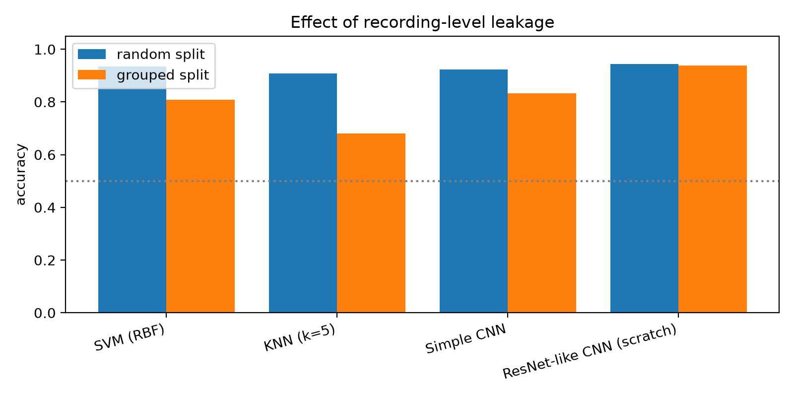

# Evaluation: does the tractor classifier generalize?

The tractor dataset (295 clips) is made of short segments cut from longer recordings. Segments of one
recording are near-duplicates, so a **random** train/test split lets the model "recognize" the recording
instead of the fault, and every metric is inflated. This folder re-evaluates the models with
**recording-grouped** cross-validation and reports what survives.

```bash
pip install -r requirements.txt          # tensorflow-cpu, librosa, scikit-learn, imageio-ffmpeg
python run_evaluation.py                 # SVM + KNN (about 1 min)
python run_evaluation.py --deep          # + simple CNN and ResNet-like CNN from scratch (about 30 min on CPU)
python run_evaluation.py --deep --pretrained path/to/resnet_like_cnn.h5   # + MIMII transfer ablation
pytest                                   # tests for the split protocol (no audio or TensorFlow needed)
```

Features and architectures are copied from `Notebook/ML_experiments.ipynb` (16 kHz, 10 s, 40 MFCC x 100 frames).
Raw numbers: [results/RESULTS.md](results/RESULTS.md), [results/results.json](results/results.json).

## Results (5-fold CV, 289 clips, 40 pseudo-recording groups)

| Model | Accuracy, random split | Accuracy, grouped split | F1, grouped | ROC-AUC, grouped |
|---|---|---|---|---|
| KNN (k=5) | 0.909 | 0.680 ± 0.192 | 0.683 | 0.763 |
| SVM (RBF) | 0.935 | 0.807 ± 0.117 | 0.762 | 0.922 |
| Simple CNN | 0.924 | 0.832 ± 0.051 | 0.745 | 0.898 |
| **ResNet-like CNN (from scratch)** | 0.945 | **0.939 ± 0.033** | **0.917** | **0.959** |



What this shows:

1. **Leakage is real.** KNN loses 23 points and the SVM 13 points once recordings are kept apart.
   SVM accuracy also climbs steadily as the grouping gets finer (0.76 at 5 groups per class to 0.93 at 70),
   which is the signature of sibling leakage rather than noise.
2. **The ResNet-like CNN is the only model that is robust to it.** This is evidence for the architecture
   choice made in the project, and it holds without any pump pretraining. It should replace the earlier
   argument that rests on MIMII pump metrics.
3. **Fold variance is large** (the SVM varies by ±0.12 across folds) with so few independent recordings,
   so differences of a few points between models are not significant. The F1 bootstrap intervals are in RESULTS.md.

## Limitations (read before quoting any number)

- **Groups are inferred, not known.** Recording identity is not stored in the dataset. Groups come from
  clustering similar-sounding clips within each class (`protocols.cluster_groups`). This is a reasonable
  proxy, not ground truth; the granularity sweep exists to show how sensitive the results are to it.
  Recording the source of every future clip would remove this uncertainty.
- **Out-of-distribution failure.** Trained on the other clips, the SVM flags **0 of 6** of the author's own
  phone recordings as abnormal. Phone microphone, environment and the way "abnormal" was produced differ
  from the Freesound clips, and 6 clips is a tiny sample, but this is the closest thing to a field test and
  it failed. The deployed model should not be assumed to work on farmers' phones until it is tested on
  field recordings (the CNNs were not run on this set).
- **Small, narrow data.** 295 clips, mostly from public sound libraries, one engine family. "Abnormal"
  labels are as provided by the clips' uploaders, not confirmed by a mechanic.
- **Transfer learning is not evaluated here.** The MIMII pump data is not in the repository, and the
  deployed transfer model was trained on all tractor clips, so it cannot be scored fairly. Run with
  `--pretrained` to add that row. Until then, "transfer learning improves tractor accuracy" is unsupported.
- **The notebook's own tractor evaluation is optimistic.** It uses a random split (cell 38) and its field
  demo (cell 42) predicts on clips it was trained on.
- Decision threshold fixed at 0.5; no calibration or cost-sensitive threshold was tuned.
